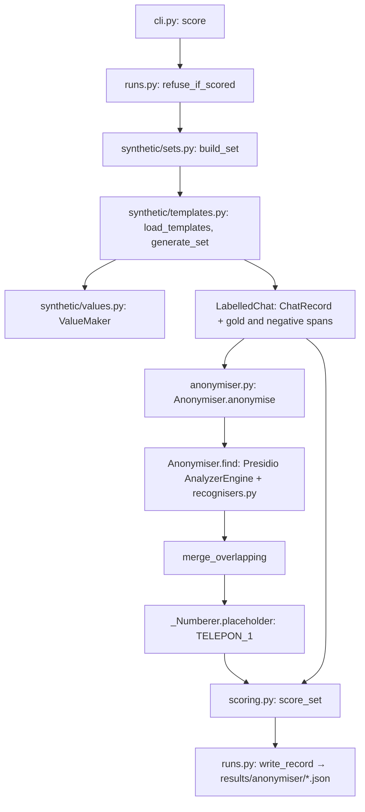

# Guide: how id-chat-research works

For anyone reading the code for the first time. What exists so far: the
chat record format, the rule-based half of the anonymiser, the synthetic
set generator and the scorer. The NER half, the rubric and the judge come
in later slices ([slice plan](planning/slice-plan.md)).

## The flow: scoring the anonymiser on the held-out set

One run of `uv run id-chat score --set heldout`, step by step:

1. **`cli.py: score`** checks the set name, then
   **`runs.py: refuse_if_scored`** stops a second held-out run for the same
   recogniser code.
2. **`synthetic/sets.py: build_set`** loads `data/templates/heldout.yaml`
   and calls **`synthetic/templates.py: generate_set`**, which fills random
   templates until there are at least 1,500 chats and 1,000 of each
   direct identifier. **`ValueMaker`** (`synthetic/values.py`) draws the
   values; **`_ChatFiller`** records where each one lands, so the labels
   are exact.
3. **`anonymiser.py: Anonymiser.anonymise`** runs each turn through
   **`find`**: Presidio's `AnalyzerEngine` with a blank Indonesian spaCy
   pipeline and the recognisers from **`recognisers.py: all_recognisers`**.
4. **`merge_overlapping`** joins overlapping matches into one redaction.
   **`_Numberer.placeholder`** gives each distinct value a numbered
   placeholder; two spellings of one phone number share it.
5. **`scoring.py: score_set`** compares redactions with the gold spans and
   counts misses, leaked characters, wrong types, over-redaction and
   look-alike hits.
6. **`runs.py: write_record`** writes the run record. The numbers in
   [`results-anonymiser.md`](results-anonymiser.md) come from it.

To anonymise your own chat records: `uv run id-chat anonymise in.jsonl
out.jsonl`. It prints only a count.

## Glossary

- **Chat record (`ChatRecord`):** one chat, in
  `packages/id-chat-records/src/id_chat_records/record.py`. Its `source`
  (synthetic, public or real) is required, so code can refuse to send a
  real chat anywhere.
- **PII:** personally identifiable information: names, phone numbers, NIKs
  and so on. `labels.py: PiiType` lists the kinds.
- **NIK:** the 16-digit Indonesian national ID number. Its digits encode
  the region and birth date; `recognisers.py: NikRecogniser` checks that
  structure.
- **Placeholder:** what replaces a value, like `<TELEPON_1>`. Numbered per
  chat, so the rubric can still see "the agent used the customer's name".
- **Recogniser:** a rule that finds one kind of PII. Ours are Presidio
  `PatternRecognizer`s (regular expressions) in `recognisers.py`.
- **Presidio:** Microsoft's open PII detection framework. We use its
  analyzer, not its anonymizer (see `anonymiser.py` for why).
- **Gold span:** where a PII value really is in a synthetic chat, known
  because the generator put it there. **Negative span:** a price or
  product that must not be redacted (a "look-alike" or hard negative).
- **Miss:** a gold value left readable: 3 or more digits, or a whole word
  of a name, address or email. `scoring.py: is_missed`.
- **Dev and held-out sets:** dev chats are for writing recognisers; held-out
  chats, from separate frozen templates, are scored once per version.
- **Score once:** a held-out set is scored only once per recogniser
  version, so it can't be tuned against. `runs.py: refuse_if_scored`.
- **Config hash:** a hash of the recogniser code, in every run record.
- **R0, R1, R2:** patterns only; plus NER; plus a local LLM sweep
  (measurement plan).
- **G1, G3:** goals from the [problem brief](planning/phase-1-problem-brief.md):
  zero missed direct identifiers; no prices or products redacted.
- **Wilson interval:** a confidence interval for a rate, sound even at 0
  misses. `scoring.py: wilson_interval`.

## Where to change things

- **Catch a new format** (a phone written a new way): add a test case to
  `tests/test_recognisers.py`, then a `Pattern` in `recognisers.py`. Add a
  dev template in `data/templates/dev.yaml` if the generator should make it.
- **Never edit `data/templates/heldout.yaml`.** A miss found on held-out
  becomes a dev template; `test_heldout_templates_are_frozen` enforces it.
- **A new kind of PII:** add it to `labels.py: PiiType`, a maker in
  `synthetic/values.py`, a recogniser, and slots in the dev templates.
- **New look-alikes to protect:** add to `labels.py: NegativeKind` and
  `synthetic/values.py`, then use the slot in templates.
- **Reference lists** (phone prefixes, plate regions, banks):
  `reference.py`.
- **Set sizes and seeds:** `synthetic/sets.py: SETS`.
- **The chat record's fields:** `id_chat_records/record.py`. A field change
  that breaks readers bumps `FORMAT_VERSION` and the package version, and
  gets a new tag; AI Flight School depends on the tag.
